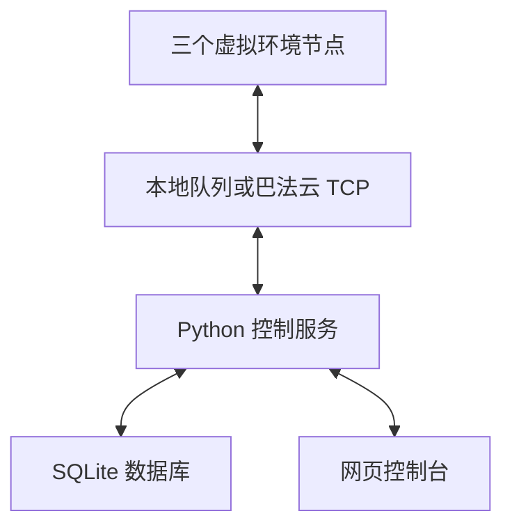

# CloudLink Lab

**基于巴法云的多设备监控与控制平台 · v2.0.0**

CloudLink Lab 用 Python 模拟三个独立环境节点，在网页中查看采样、发送风扇指令和查询历史。支持本地消息仿真与巴法云 TCP 通信，可复现设备路由、发布订阅、控制回执、断线恢复和数据持久化流程。

环境温湿度和风扇均由软件模拟。选择巴法云模式后，采样、命令和回执通过真实云服务传递。运行完整平台需要 Python 3.10+，后端使用 Python 标准库。

## 功能

| 功能 | 实现 |
| --- | --- |
| 多设备管理 | ENV-001、ENV-002、ENV-003，独立运行状态、模式、阈值和故障场景 |
| 实时监控 | 温湿度、接收时间、设备在线状态、温度历史曲线 |
| 历史存储 | SQLite 保存采样、设备设置、指令和事件，刷新或重启后可查询 |
| 可靠控制 | 唯一指令编号、执行回执、最多 3 次发送尝试、5 秒确认期限 |
| 幂等处理 | 重试沿用同一编号，重复消息只补发已记录的原回执 |
| 自动恢复 | 断线后指数退避重连，重新订阅，过期指令结束处理 |
| 自动控制 | 每台设备独立阈值，1°C 回差，自动指令间隔至少 8 秒 |
| 故障实验 | 正常环境、升温、约 45% 消息丢失、设备离线 |
| 数据查询 | 按设备和时间范围查看采样，CSV 导出最多 10 万条 |

## 快速运行

1. 下载仓库 ZIP 并完整解压，或克隆仓库。
2. 安装 Python 3.10 或更新版本。
3. Windows 双击 `Start_CloudLink.bat`，也可在项目目录运行以下命令。

```bash
python server.py
```

macOS / Linux 可使用 `python3 server.py`。浏览器自动打开 `http://127.0.0.1:8765`，默认进入多设备本地仿真。

设备运行在 Python 进程中。关闭网页后仍会继续采样，关闭启动窗口或按 Ctrl+C 后停止。再次启动恢复设备设置，连接私钥需重新填写。

双击 `index.html` 会进入独立的 `preview.html` 单设备浏览器仿真。这一模式的数据仅保存在页面内存中。完整的多设备、SQLite 和云连接功能通过 Python 启动入口运行。

## 连接巴法云

登录 [巴法云控制台](https://cloud.bemfa.com/)，在 **TCP 设备云**创建两个主题。v1 已使用的主题可以继续使用。

| 默认主题 | 用途 |
| --- | --- |
| `cltelemetry004` | 温湿度采样与执行回执 |
| `clcontrol003` | 风扇控制命令 |

在本地网页的「连接巴法云」页填写用户私钥和两个主题，点击连接，等待显示「巴法云 · 真实传输」。三个节点共用两个主题，通过消息中的 `device_id` 分发到对应节点。

私钥只保存在程序内存中，不写入 SQLite、配置文件或事件日志。`data/` 已加入 Git 忽略规则。巴法云 TCP 使用 `bemfa.com:8344`，本适配器没有 TLS，运行范围为学习与演示。

## 结构与消息流



### 采样

每个运行中的节点每 3 秒生成一条含唯一编号的采样，经当前消息通道发布。服务收到消息后验证设备编号与数值范围，再写入 SQLite。网页每秒查询已接收的采样与回执。

### 控制

1. 网页生成唯一指令编号，提交设备编号和开关动作。
2. 服务保存指令，再向控制主题发送。
3. 对应虚拟节点收到命令，记录执行结果并改变模型风扇状态。
4. 设备发布同编号回执，服务确认后记录往返耗时。
5. 每隔至少 1 秒重试未确认的指令，总计最多 3 次，超过 5 秒转为超时。

重试沿用同一编号。首次执行时，把结果和设备状态放在同一个 SQLite 事务内。之后的重复命令只发送已有回执。即便最初 HTTP 响应丢失，浏览器用同一编号再提交也会得到原指令记录。

程序重启或切换传输模式时，尚未确认的指令标记为 `interrupted`。超时指令和中断指令在网络恢复后不会重新执行。超时表示确认未在期限内到达，设备可能已经执行，可结合后续采样和执行记录判断。

### 断线恢复

收到订阅成功响应后才显示已连接。断线、订阅确认超时或心跳超时进入重连，等待 1、2、4、8、16、30 秒，随后保持 30 秒上限。稳定连接至少 30 秒后重置退避计数。

每次新连接重新订阅两个主题。连接状态、下次重试时间和重连次数显示在连接页。接收线程处理 TCP 分片与多条消息合并，旧连接回调按连接代次过滤。

## 数据库

首次启动创建 `data/cloudlink.sqlite3`，采用 WAL 模式。

| 表 | 内容 |
| --- | --- |
| `devices` | 节点编号、阈值、模式、场景、虚拟执行状态 |
| `telemetry` | 唯一采样编号、设备、接收时间、温湿度、风扇和传输模式 |
| `commands` | 编号、设备、动作、尝试次数、执行和确认时间、最终状态 |
| `events` | 报警、控制和连接事件 |

历史页面显示筛选后的最近 120 条采样、最近 20 条指令和最近 100 条相关事件。CSV 导出相同设备和时间条件下最近 10 万条采样，按时间升序输出。

## 源码

| 文件 | 职责 |
| --- | --- |
| `server.py` | 本机 HTTP 服务、参数验证、状态 API 和 CSV |
| `engine.py` | 设备模型、自动控制、分发、重试和回执状态机 |
| `transport.py` | 巴法云 TCP、心跳和自动重连 |
| `storage.py` | SQLite 表、查询和持久化 |
| `index.html` / `app.js` / `style.css` | 多设备操作界面 |
| `preview.html` | 独立单设备浏览器仿真 |
| `tests/test_system.py` | 设备隔离、幂等、恢复、协议和 API 回归检查 |

## 验证

在项目根目录运行，无需安装测试依赖。

```bash
python -m unittest discover -s tests -v
```

11 项检查覆盖设备隔离、回执校验、丢失回执后的幂等重试、离线超时、设置与历史恢复、重启后的待处理指令、自动控制回差、采样校验与去重、TCP 分片及重新订阅、本地 HTTP API 与 CSV，以及通过模拟云的三设备完整采样与控制回路。

v1 已由使用者在 Windows 完成真实巴法云采样与控制回执联调。v2 的自动化协议测试使用本机模拟 TCP 服务，升级后的真实账号联调需在运行环境中再次确认。当前开发环境浏览器预览受限，未完成 v2 浏览器端人工验收。

## 升级与运行范围

先关闭旧版启动窗口，再把最新版解压到新文件夹并启动。原有两条巴法云主题可以继续使用，私钥在本地填写。

v1 页面内存中的采样无法迁移到 SQLite。v2 设置和历史存于 `data/`，后续替换源码时保留该目录即可。连接私钥在每次启动后重新填写。

服务只绑定本机地址，使用一个 Python 进程运行。采样和事件持续存储，暂未加入自动清理。设备是软件模型，数据库保存在当前电脑，不提供跨电脑数据库同步。

可选参数如下。

```bash
python server.py --port 8766 --no-browser --database data/demo.sqlite3
```

## 协议参考

[巴法云 TCP 官方文档](https://cloud.bemfa.com/docs/src/tcp.html)
